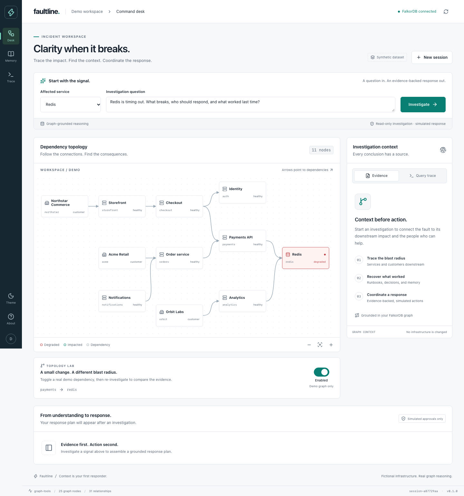
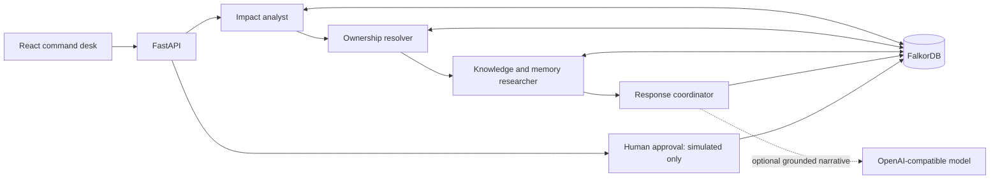
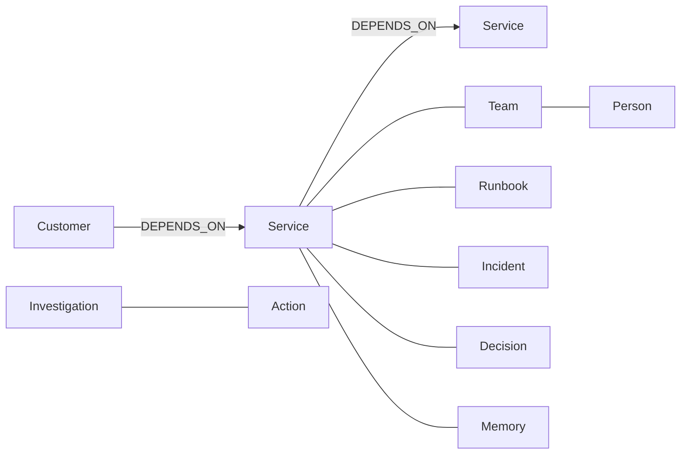

# Faultline

### Your incident has a blast radius. Your agent should know it.

Faultline is a graph-grounded incident command desk. Start with a failing service; follow its dependencies to affected products and customers; find the people responsible; recover previous incident knowledge; and draft a response with an inspectable evidence trail.

**Built for [Graph Hacks: Context for AI Agents](https://www.wemakedevs.org/hackathons/falkordb) · Powered by FalkorDB · MIT licensed**



## The problem

“Redis is timing out” isn't enough context to act. The useful questions cross records:

- Does the storefront depend on it indirectly?
- Which customers are downstream, and who owns the affected services?
- What did the team try last time? What should we *not* repeat?
- Can we show the actual relationship behind a recommendation?

A document similarity search can find a Redis runbook. It cannot, by itself, establish the live chain **Northstar Commerce → Storefront → Checkout → Payments API → Redis**. Faultline traverses that chain in FalkorDB before making a plan.

## Run it — no AI key required

Requires **Docker with Compose**, a running Docker engine, and internet access for the first build.

```bash
git clone https://github.com/RavitejaKarra24/faultline-graph-agent.git
cd faultline-graph-agent
docker compose up --build -d
```

Open **http://localhost:8080**. First build can take a few minutes.

| URL | Purpose |
| --- | --- |
| http://localhost:8080 | Incident command desk |
| http://localhost:8000/docs | Interactive API documentation |
| http://localhost:8000/api/health | Backend / FalkorDB health |
| http://localhost:3000 | FalkorDB Browser |

The fictional company graph seeds automatically. No credentials, paid models, or external integrations are needed. FalkorDB is mandatory at runtime: an unavailable database produces a real error, **not a fake offline response**.

```bash
docker compose logs -f api      # Troubleshoot startup
docker compose down             # Stop; keep graph and memory
docker compose up -d            # Resume with persisted memory
# DESTRUCTIVE: docker compose down -v removes all demo graphs and memory.
```

## A two-minute judge's walkthrough

1. **Investigate Redis.** Keep the default question and run an investigation. Inspect affected services, customers, and owners.
2. **Follow the proof.** Open evidence paths and the query trace. Each tool records its actual Cypher, parameters, result count, and elapsed time.
3. **Remember a lesson.** Add an `avoid` memory for Redis, such as “Do not restart Redis during checkout traffic; drain the payment connection pool first.”
4. **Start a new session.** Investigate again. The saved memory remains available to the response coordinator; it is stored in FalkorDB, not browser storage.
5. **Change the graph.** Disable the Payments API → Redis dependency using the topology control, then rerun the investigation. The payment branch no longer contributes to Redis's blast radius. Re-enable the edge afterward.
6. **Approve a draft action.** Approval is persisted and visible, but is explicitly simulated: no page is sent and no infrastructure is modified.

See [the demo script](docs/DEMO.md) for narration and [submission copy](docs/SUBMISSION.md) for the entry form.

## Why this is a graph agent, not a chatbot over a diagram

FalkorDB is the primary context and memory store. It determines:

- **What to investigate:** reverse traversal of enabled dependency edges, up to six hops.
- **Who is affected:** customer-to-service paths, not keyword matching.
- **Who should respond:** ownership relationships for the affected services.
- **What to do next:** connected runbooks, prior incidents, decisions, and persistent helpful/avoid lessons.
- **Why:** concrete node paths and source IDs accompany the response.

The topology toggle is a falsifiable demo: change one relationship and the answer changes. The graph isn't decorative, and there is no parallel in-memory graph answering the question.

### Execution modes — transparent by design

**`graph-tools` (default):** a bounded, deterministic agent workflow coordinates impact analysis, ownership resolution, knowledge/memory retrieval, and response planning. It uses actual graph tools but **does not use an LLM**. These are specialist stages in one process, not separate independently running AI models. This mode is reproducible, key-free, and appropriate for a time-sensitive demo.

**`llm` (optional):** after graph tools complete, an OpenAI-compatible model can synthesize the narrative from the retrieved context. The model does not invent Cypher, select arbitrary tools, or execute actions. Structured evidence, impact, and approval boundaries remain graph-derived. If synthesis fails, the grounded plan remains available with a warning.

```bash
cp .env.example .env
# Edit .env: set OPENAI_API_KEY and optionally OPENAI_MODEL.
docker compose up -d --force-recreate api
```

**Privacy:** enabling model synthesis sends investigation context, including relevant saved lessons, to the configured model provider. Use synthetic data unless you have permission.

## Architecture



### Graph model



See [architecture and tradeoffs](docs/ARCHITECTURE.md) for exact relationships, isolation, persistence, and limitations. [CONTRACT.md](CONTRACT.md) documents the API. FastAPI's `/docs` is the generated schema reference.

## Local development

Requires **Python 3.12**, [uv](https://docs.astral.sh/uv/), [Bun 1.4.3+](https://bun.sh/), and Docker.

```bash
# Terminal 1: graph database
docker compose up -d falkordb

# Terminal 2: API
cd backend
uv sync --frozen
uv run uvicorn faultline_backend.app:app --reload --host 127.0.0.1 --port 8000

# Terminal 3: web UI (from repository root)
cd frontend
bun install --frozen-lockfile
bun run dev --host 127.0.0.1
```

Open the Vite URL printed in terminal. `/api` requests proxy to port 8000. Docker's port-8080 app and the local dev app share the same graph if they use the default workspace.

### Checks

```bash
make check             # Backend unit tests, Ruff, TypeScript, frontend lint/format/build
make integration       # Real FalkorDB integration tests; database must be running
```

The integration suite is deliberately separate from unit tests: **mock-only tests cannot prove Cypher works**. Browser smoke coverage and reproducible test instructions are documented in [testing](docs/TESTING.md).

## Repository

```text
backend/       FastAPI, parameterized graph tools, planner, fixture, tests
frontend/      React + TypeScript command desk and topology visualization
infra/         Multi-stage Dockerfiles and nginx reverse proxy
scripts/       Reproducible browser smoke test
compose.yaml   FalkorDB + API + UI, local-only exposed ports, persistent volume
docs/          Architecture, demo, testing, submission copy, blog draft
```

## Scope, safety, and honest limitations

- All seeded infrastructure, customers, people, incidents, and documents are **fictional**. This is a working prototype, not a production incident platform.
- **Actions are drafts.** “Approve” records a simulated approval in the graph; it does not call Slack, PagerDuty, Kubernetes, or cloud APIs.
- No authentication/RBAC is included. Workspace headers provide graph namespaces, **not access control**. Compose binds ports to loopback. Do not expose this demo publicly without authentication, TLS, rate limits, and protected database credentials.
- Traversals are bounded at six dependency hops. The fixture represents explicit dependency facts, not real-time telemetry or causal root-cause proof.
- Memory is explicit operator input. There is no automatic extraction from Slack/GitHub, vector retrieval, memory decay, or contradiction resolution.
- The graph-tools workflow is deterministic. Optional LLM mode adds narrative synthesis, not open-ended autonomous planning.
- A single-instance persistent volume and synchronous workflow are sufficient for this demo; high-concurrency coordination, job queues, locking, and distributed worker claims are not implemented.

## Hackathon fit

| Track | Implemented demonstration |
| --- | --- |
| **01 · Agents That Act on Connected Data** (primary) | Multi-hop impact reasoning, parameterized Cypher tools, evidence-linked action drafts, human approval |
| **02 · Agent Memory and Coordination** | Cross-session lessons, graph-persisted investigations/actions, shared context across specialist stages, workspace namespaces |
| **03 · Company Brain** | Services, teams, people, customers, runbooks, historical incidents, and decisions connected in one graph |

Built with coding-assistant support. The submitter should review the code, run the demo, and be prepared to explain the graph model and planner. See [LICENSE](LICENSE).
